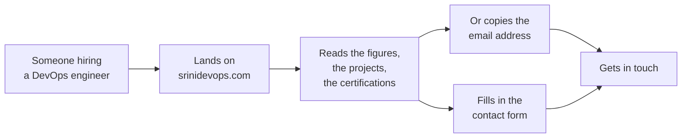
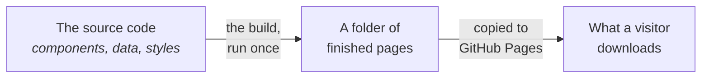
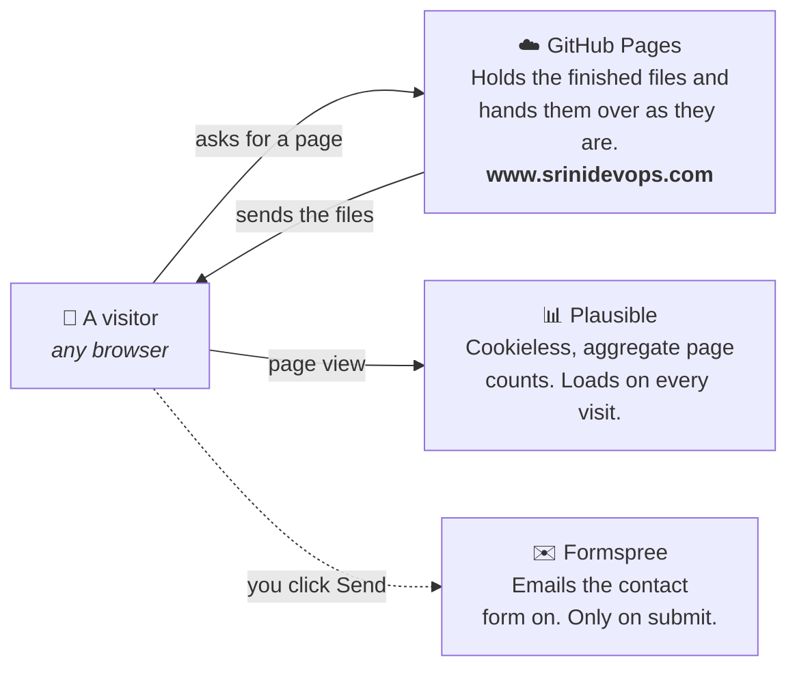
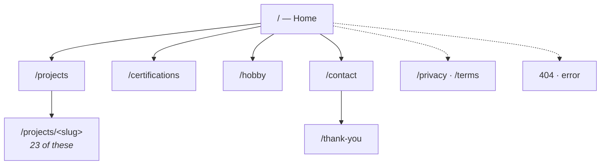
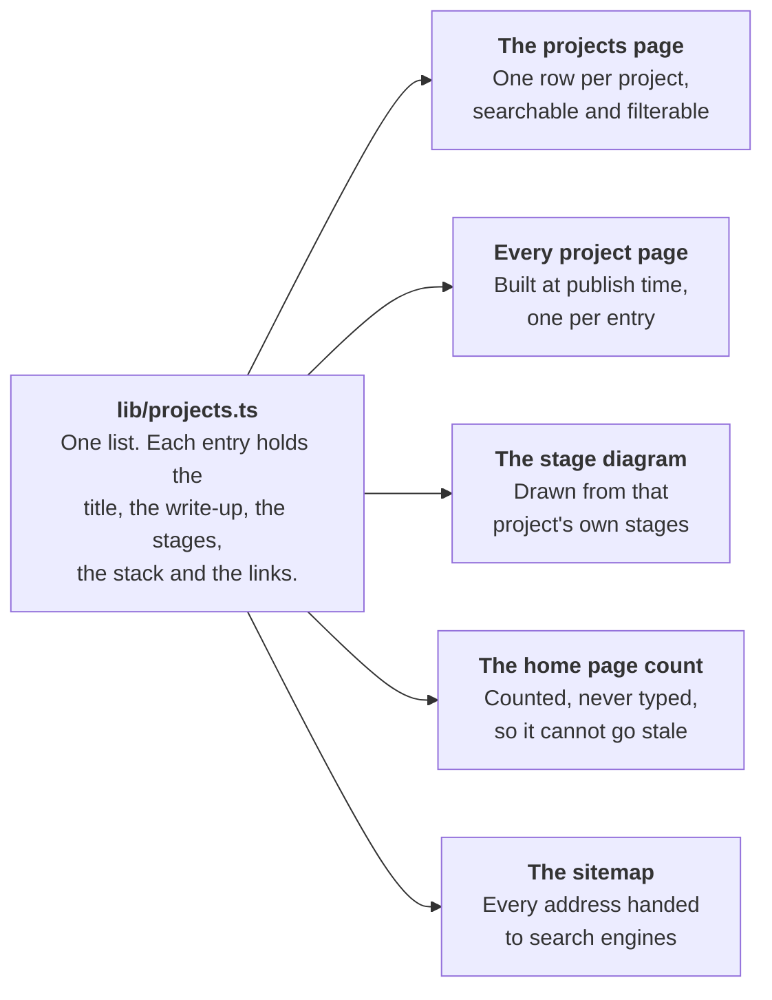
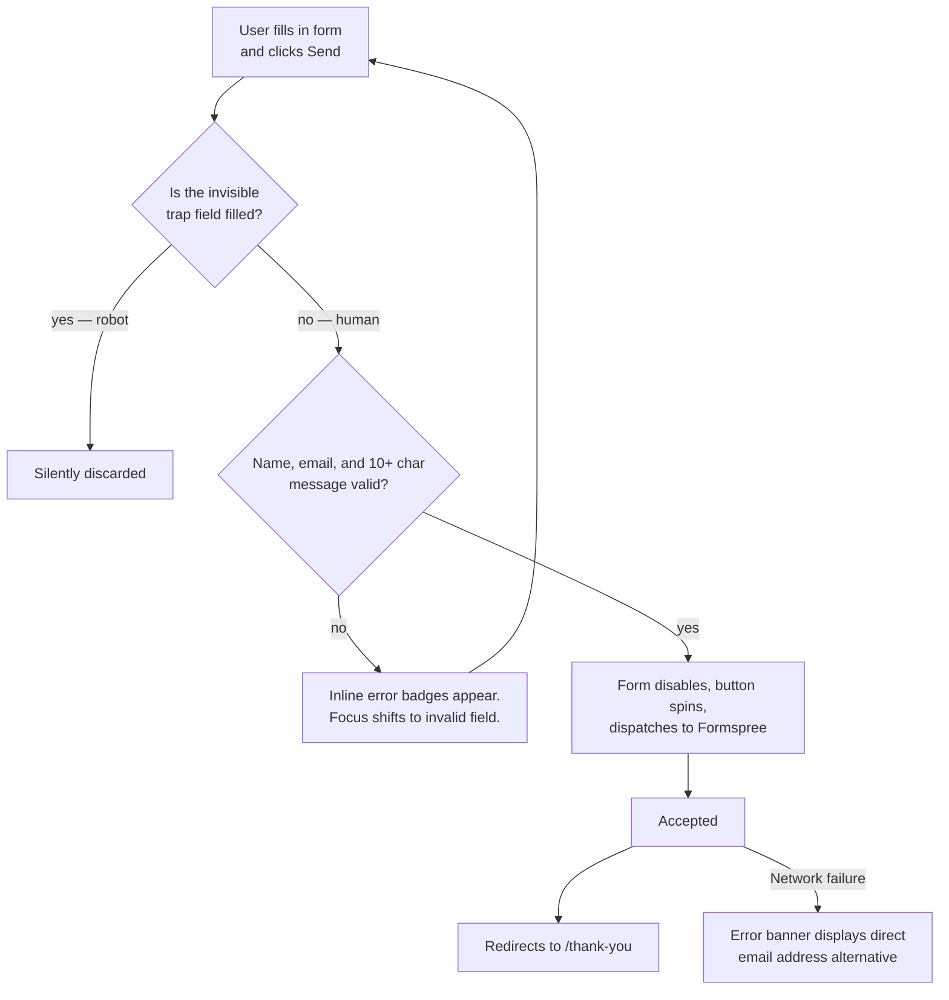
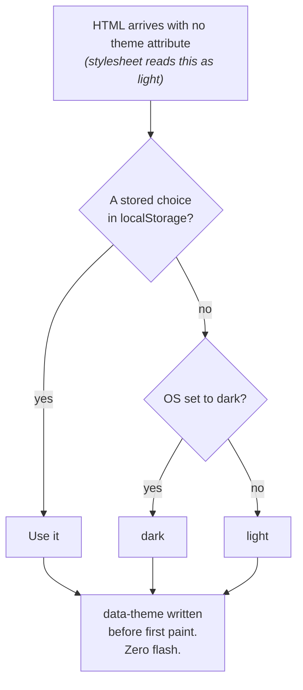
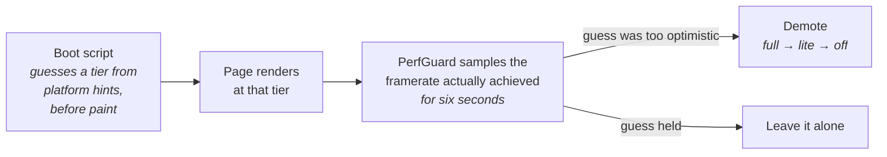
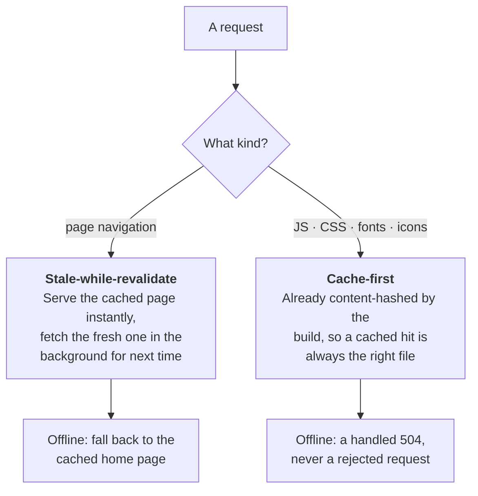
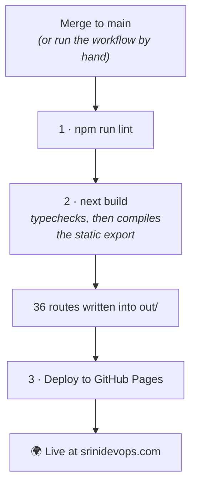

# srinidevops.com — the whole site, explained

This repository is a personal website: the portfolio of **Srinivasan Vijayaraghavan**,
a DevOps & Site Reliability engineer in Bangalore. It lives at **[www.srinidevops.com](https://www.srinidevops.com)**.

The unusual thing about it is what is *missing*. There is no database. There is no
server sitting in a data centre waiting for visitors. The entire site is a pile
of ready-made static files that a browser downloads and renders, which is why it is fast, free
to host, and impossible to knock over.

---

## Table of contents

1. [The one-minute version](#1-the-one-minute-version)
2. [Explaining it plainly](#2-explaining-it-plainly)
3. [What is on the screen](#3-what-is-on-the-screen)
4. [The pages, one by one](#4-the-pages-one-by-one)
5. [What happens when you open the site](#5-what-happens-when-you-open-the-site)
6. [Type it once, use it five times](#6-type-it-once-use-it-five-times)
7. [The contact form, with no post office](#7-the-contact-form-with-no-post-office)
8. [Light, dark, and the flash that never happens](#8-light-dark-and-the-flash-that-never-happens)
9. [Movement, and knowing when to stop](#9-movement-and-knowing-when-to-stop)
10. [The second visit, and the one with no signal](#10-the-second-visit-and-the-one-with-no-signal)
11. [The map of the repository](#11-the-map-of-the-repository)
12. [How it gets onto the internet](#12-how-it-gets-onto-the-internet)
13. [Running it on your own computer](#13-running-it-on-your-own-computer)
14. [Contact & credentials](#14-contact--credentials)

---

## 1. The one-minute version



Everything in this repository exists to move a visitor from box **B** to box **F**.

**The numbers, as the site stands today:** 23 production builds, 24 verified
certifications, five primary navigation routes, and 36 statically compiled routes
produced by the Next.js build.

---

## 2. Explaining it plainly

Most websites work like a restaurant. You ask for a page, a kitchen somewhere cooks
it fresh — looks things up in a database, assembles the page, sends it back — and you
wait while that happens. Every visitor makes the kitchen work again.

This site works like a **vending machine**. Every page was made in advance, wrapped,
and stacked in the machine. When you ask for one, it drops out. Nobody cooks anything.

Making them in advance is a job called **the build**. It happens once, on a computer
GitHub lends us for a few minutes, and it turns the source code in this repository
into a folder of finished pages (`out/`). That folder is what visitors actually get.



Three things follow from that, and they explain most of this repository:

- **It cannot go down under load.** Handing over a static file is the easiest thing a
  web server does. A thousand visitors at once is not a problem to solve.
- **It costs nothing.** GitHub Pages hosts it free with global edge distribution.
- **It cannot keep a secret.** Anything shipped to the browser can be read by anyone
  who looks. So this site holds no secret at all — there is no API key and no
  server-side code. It contacts exactly two third parties: Plausible, for a
  cookieless page count, and Formspree, but only at the moment you submit the
  contact form.

Here is the whole thing in one picture — four boxes, and one of them is optional:



**On the privacy notice, precisely.** The band at the bottom of the page is a
**disclosure, not a consent gate** — and that is a deliberate decision, recorded in
`components/CookieNotice.tsx`. Its button says "Got it", not "Accept". Nothing is
withheld until you dismiss it and dismissing it grants nothing: Plausible loads on
every visit either way. That is defensible *because* of what Plausible is here —
cookieless, aggregate-only, setting no identifier — and the only thing this site
writes to your browser is the flag recording that you closed the notice (plus your
theme choice, if you pick one). If a cookie-setting tool is ever added, the notice has
to become a real opt-in gate that blocks the script until accepted.

---

## 3. What is on the screen

Every page is assembled from the same small set of components. The chrome, mounted
once in `app/layout.tsx`:

| Part | What it is | Where it lives |
| --- | --- | --- |
| **Boot script** | A few lines that run before the first pixel is drawn: sets the theme and guesses an effects tier from platform hints. | `components/BootScript.tsx` |
| **Header** | The site name, five numbered destinations, and the light/dark switch. Sticks to the top as you scroll. | `components/Nav.tsx` |
| **Skills ticker** | Thirty-nine tool marks in continuous rotation, directly under the header. Deliberately *not* links. | `components/SkillTicker.tsx` |
| **Bat ground** | One large mark, fixed behind every page, furthest back in the stack. | `components/primitives/BatGround.tsx` |
| **Interaction layer** | A click spark and a targeting reticle for a cursor. Renders its children straight through until it has checked pointer type and motion preference. | `components/primitives/InteractionFx.tsx` |
| **Perf guard** | Samples the framerate the page actually gets, then lowers the effects tier if the boot guess was wrong. Renders nothing; runs for six seconds and disconnects. | `components/primitives/PerfGuard.tsx` |
| **Footer** | Set as a technical drawing's title block: links, legal, copyright. | `components/Footer.tsx` |
| **Privacy notice** | A quiet ruled band. A disclosure, not a consent gate — see §2. | `components/CookieNotice.tsx` |

The home page is then six numbered **cases**:

| | Case | What it is |
| --- | --- | --- |
| — | **Hero** | The name, the role, and one sentence. `components/home/Hero.tsx` |
| 01 | **Figures** | Six counted figures, set as a scoreboard. None of them is typed by hand. `components/home/Figures.tsx` |
| 02 | **Release path** | The release flow and its rollback path, drawn from real deployment data. `components/home/ReleasePath.tsx` |
| 03 | **Loadout** | Seven engineering domains, 47 skills, selectable. `components/home/Loadout.tsx` |
| 04 | **Initiatives** | Twenty enterprise initiatives across Thomson Reuters and Granite River Labs. `components/home/Initiatives.tsx` |
| 05 | **Clearance** | Work authorization, with live synchronized clocks for EST, IST and UTC. `components/home/Clearance.tsx` |

Two things deserve a note:

**The skills ticker is not a set of links.** A row of thirty-nine logos that are all
links puts thirty-nine keyboard stops between "skip to content" and the actual
navigation, and every one of them leaves the site — while moving, under a pointer
that is trying to land on one. They are a statement of what the work is made of, so
they are inert.

**On a narrow screen the header links are replaced by a disclosure panel**
(`components/Nav.tsx`, below the `sm:` breakpoint). Both interfaces read the same
list in `lib/nav.ts`, so a new page appears in both or in neither.

---

## 4. The pages, one by one



| Page | What it is for |
| --- | --- |
| **Home** (`app/page.tsx`) | The engineering story in six cases: hero, counted figures, release path, skills loadout, enterprise initiatives, work-authorization clearance. |
| **Projects** (`app/projects/page.tsx`) | Searchable directory of 23 builds with category filters and live counts, hosted demo links and GitHub repositories. |
| **Project detail** (`app/projects/[slug]/page.tsx`) | 23 static pages: system architecture, execution flow, highlights, stack, and sequential Previous/Next pagination. |
| **Certifications** (`app/certifications/page.tsx`) | 24 verified credentials, grouped into rows, with instant keyword search and permanent verification links. |
| **Hobby** (`app/hobby/page.tsx`) | The games shelf, by genre. `components/gaming/GameBoard.tsx`. |
| **Contact** (`app/contact/page.tsx`) | Accessible contact form with live character counter, haptic feedback, Formspree dispatch, and a 1-click clipboard email card. |
| **Thank you** (`app/thank-you/page.tsx`) | Delivery confirmation. Marked `noindex` so it never appears in search results. |
| **Privacy / terms** (`app/privacy/page.tsx`, `app/terms/page.tsx`) | Dual-theme legal notices explaining cookieless analytics and static hosting. |
| **404 / error** (`app/not-found.tsx`, `app/error.tsx`, `app/global-error.tsx`) | Error boundaries and dead-end catchers with quick-navigation cards. |

---

## 5. What happens when you open the site

```mermaid
sequenceDiagram
    participant You as 🧑 You
    participant B as 🌐 Your browser
    participant GH as ☁️ GitHub Pages

    You->>B: type srinidevops.com
    B->>GH: send me the home page
    GH-->>B: index.html
    Note over B: A tiny script runs before<br/>anything is drawn: dark or light?<br/>Decided in the first millisecond,<br/>so there is no flash.
    B->>GH: the styles, the fonts, the code
    GH-->>B: here they are
    B-->>You: the page appears
    Note over B: Sections reveal as you reach them.<br/>The privacy notice arrives last.<br/>It discloses; it does not gate.
```

The fonts are self-hosted — downloaded from GitHub Pages with everything else, never
fetched from an external font service. There are four, each with one job:

- **Archivo Black** — headlines. A heavy geometric grotesque, so a headline lands as a
  block of ink rather than a line of lettering.
- **Oswald** — figures and the poster moments. Condensed and tall, which is what gives
  a stat block the vertical drama a wide face cannot.
- **Inter Tight** — the prose, because the prose here is genuinely long.
- **JetBrains Mono** — annotation only: labels, case numbers, the contingency line.

The stylesheet is also inlined into each page at build time
(`experimental.inlineCss`), so the first paint needs no second request.

---

## 6. Type it once, use it five times

The projects are not hardcoded into individual pages. They live in one dataset —
`lib/projects.ts` — and five separate parts of the site read that same list.



The other datasets work the same way, and all of them are presentation-free — pure
data, no JSX, no icon imports:

- `lib/projects.ts` — 23 project records.
- `lib/certs.ts` — 24 verified credentials, plus the rows they group into.
- `lib/nav.ts` — the canonical routes, shared by the desktop header and the mobile panel.
- `lib/data/profile.ts` — identity, page copy, the six figures, contact channels, legal.
- `lib/data/experience.ts` — 20 initiatives, tenure, companies.
- `lib/data/skills.ts` — 7 domains / 47 skills, and the tooling strip.
- `lib/data/authorization.ts` — 3 regions, their clocks, the notice.
- `lib/data/pipeline.ts` — the release flow and the rollback path.
- `lib/data/gaming.ts` — the games shelf, by genre.
- `lib/seo.ts` — the metadata and social-graph builder every page's `metadata` runs through.

---

## 7. The contact form, with no post office

A static site cannot run a mail daemon. So the contact form dispatches through
**Formspree**.



Key implementations:

- **Honeypot protection**: a hidden `_gotcha` field silently drops automated spam.
- **Progressive enhancement**: the `action` and `method` are set on the `<form>` itself,
  so it works as a native HTML form even with JavaScript disabled.
- **Tactile feedback**: haptics fire on submit and on validation errors (`lib/haptics.ts`).
- **One-click email copy**: a dedicated card copies the address with toast confirmation
  (`components/CopyEmailCard.tsx`).

---

## 8. Light, dark, and the flash that never happens

`<html>` ships from the server with **no** `data-theme` attribute, which the stylesheet
reads as light — so light is what a visitor with JavaScript disabled gets. The boot
script then writes the real value *before the first pixel paints*: your stored choice
if you have one, otherwise whatever your operating system is set to.



The two palettes are **independently authored** rather than one inverted into the
other, and they live in a `@theme inline` block in `app/globals.css`. `inline` is the
load-bearing word: it makes the generated colour utilities reference the custom
property instead of copying its value, which is what lets a class like `text-body`
resolve per theme at runtime rather than being baked in at build time.

| | Light | Dark |
| --- | --- | --- |
| **Ground** | `#ffffff` | `#0b0b0b` |
| **Signal** | `#866900` | `#f5c518` |

Contrast was measured for all 14 pairings in both themes, and the figures are recorded
in `app/globals.css` next to the tokens. Body text clears 4.5:1 against its own ground
in both.

---

## 9. Movement, and knowing when to stop

Animation here is compositor-driven: section reveals and counted figures run through
`IntersectionObserver` and CSS transitions, never tied to continuous scroll ticks.

The heavier effects — the WebGL backdrops, the glitch headings, the click sparks — are
governed by a **three-tier effects budget** that the whole site keeps:



The tier is decided twice because "slow device" is not something one signal can tell
you. The watchdog only ever demotes, so a bad guess costs a visitor a quieter page
rather than a janky one. Every WebGL component is behind a `next/dynamic` import with
`ssr: false` (`components/primitives/FxBackdrop.tsx`), so the `ogl` renderer is a
separate chunk that a visitor on the `off` tier never downloads.

**Accessibility first**: with `prefers-reduced-motion: reduce`, the animations,
transforms and canvas loops are removed — all of them, not most of them.

---

## 10. The second visit, and the one with no signal

`public/sw.js` is a service worker registered on the first visit (never on
`localhost`). It does two different things, because pages and assets want opposite
strategies:



Two details that are easy to get wrong and are handled here: the background
revalidation is held open with `event.waitUntil`, because a worker can be killed the
moment `respondWith` settles — without it the "revalidate" half never happens and the
snapshot stays stale forever. And every path ends at a real `Response`, because
`respondWith` rejects anything else and would surface a handled cache miss to the
visitor as a failed request.

---

## 11. The map of the repository

```
app/                        Next.js App Router, static export
  layout.tsx                Root frame: fonts, metadata, JSON-LD, chrome, theme boot
  page.tsx                  Home: hero + five numbered cases
  projects/page.tsx         Projects directory with search and category filters
  projects/[slug]/page.tsx  23 static project pages with Previous/Next pagination
  certifications/page.tsx   24 verified credentials with search
  hobby/page.tsx            The games shelf
  contact/page.tsx          Contact form and copy-to-clipboard email card
  privacy · terms · thank-you · not-found · error · global-error · loading · template
  sitemap.ts · robots.ts · manifest.ts    Framework-native metadata generators
  globals.css               Two authored palettes, three type registers, the whole theme

components/
  Nav · Footer · SkillTicker · CookieNotice · Analytics · BootScript
  ProjectIndex · CertIndex  Search and filter engines
  ContactForm · CopyEmailCard · ThemeToggle
  home/                     Hero · Figures · ReleasePath · Loadout · Initiatives · Clearance
                            CaseHead · Clocks · Tally · InitiativeDeck · LoadoutSelect
  gaming/GameBoard          The games shelf, by genre
  legal/LegalSections       Shared renderer for the privacy and terms pages
  primitives/               Panel · SectionHead · SpecBlock · TagRow · Disclose · Reveal
                            Icon · BrandMark · BrandSprite · BatGlyph · BatGround · BatTransit
                            CountUp · DecryptText · GlitchHeading · ScanField · Spotlight
                            Texture · InteractionFx · FxBackdrop · PerfGuard
  reactbits/                Vendored WebGL and text effects, each behind next/dynamic:
                            Beams · Dither · FaultyTerminal · LightRays · LetterGlitch
                            GlitchText · ClickSpark · TargetCursor

lib/                        Datasets and shared utilities — no JSX, no icon imports
  projects.ts               23 project records
  certs.ts                  24 verified credentials and their rows
  nav.ts                    Canonical route definitions
  seo.ts                    Metadata and social-graph builder
  data/                     profile · experience · skills · authorization · pipeline
                            gaming · brandPaths
  useTheme.ts · usePerfTier.ts · haptics.ts · batGround.ts

public/                     Icons, résumé PDF, OG image, bat sprites, CNAME,
                            sw.js (service worker), _headers (edge headers)
scripts/                    gen-brand-paths · make-brand-assets  (asset generators)
.authormark/                Authorship watermark tooling — see AGENTS.md
docs/                       deployment-headers · design-contingency · redesign-todo
.github/workflows/          deploy · authormark · dependency-review · provenance
                            dependabot-automerge
```

---

## 12. How it gets onto the internet



A push to `main` publishes. `workflow_dispatch` is still there so a deploy can be
forced without a commit, and both share one concurrency group so they cannot race
each other onto Pages.

**One caveat worth knowing.** `public/_headers` carries the Content-Security-Policy,
HSTS and caching headers — but GitHub Pages cannot set response headers at all, so it
serves that file as inert static text. The part of a CSP that a `<meta>` tag can
express (`base-uri`, `object-src`) ships in `app/layout.tsx` instead. The rest takes
effect the moment the site is fronted by an edge that reads `_headers`, with no code
change. See `docs/deployment-headers.md`.

---

## 13. Running it on your own computer

**Requirements**: Node.js 20+ (Node.js 22 is what CI uses).

```bash
# 1. Install dependencies
npm install

# 2. Run the local development server
npm run dev          # http://localhost:3000

# 3. The same checks CI runs, in the same order
npm run lint         # eslint-config-next, including the a11y and hook rules
npm run typecheck    # tsc --noEmit, strict
npm run build        # static export into out/
```

Two things to know before you edit:

- **Every source file starts with an `@authormark` block.** It is a watermark, not
  boilerplate, and it must never be deleted or moved. Editing a file makes its
  fingerprint stale, which is expected — refresh the tree with
  `node .authormark/authormark.mjs stamp . --zw` and re-seal with
  `node .authormark/authormark.mjs seal` before committing. CI fails on a missing
  watermark. See `AGENTS.md`.
- **This Next.js has breaking changes from what you may remember.** Read the relevant
  guide in `node_modules/next/dist/docs/` before writing code against it.

---

## 14. Contact & credentials

- **Role**: DevOps / Site Reliability Engineer — cloud infrastructure, reliability, release automation, AI developer tooling
- **Direct email**: [srinivasan.shyam2000@gmail.com](mailto:srinivasan.shyam2000@gmail.com)
- **Phone**: [+91 97910 25934](tel:+919791025934)
- **Website**: [srinidevops.com](https://www.srinidevops.com)
- **LinkedIn**: [linkedin.com/in/srini-solution-architect](https://www.linkedin.com/in/srini-solution-architect/)
- **GitHub**: [github.com/Srinivasan-78](https://github.com/Srinivasan-78)
- **Open source**: [repo2graph](https://github.com/Srinivasan-78/repo2graph) — creator and maintainer of an MIT-licensed code-graph engine and MCP server for AI coding agents
- **Location**: Bangalore, India — U.S. Citizen · OCI Holder (authorized to work in the United States and India)
